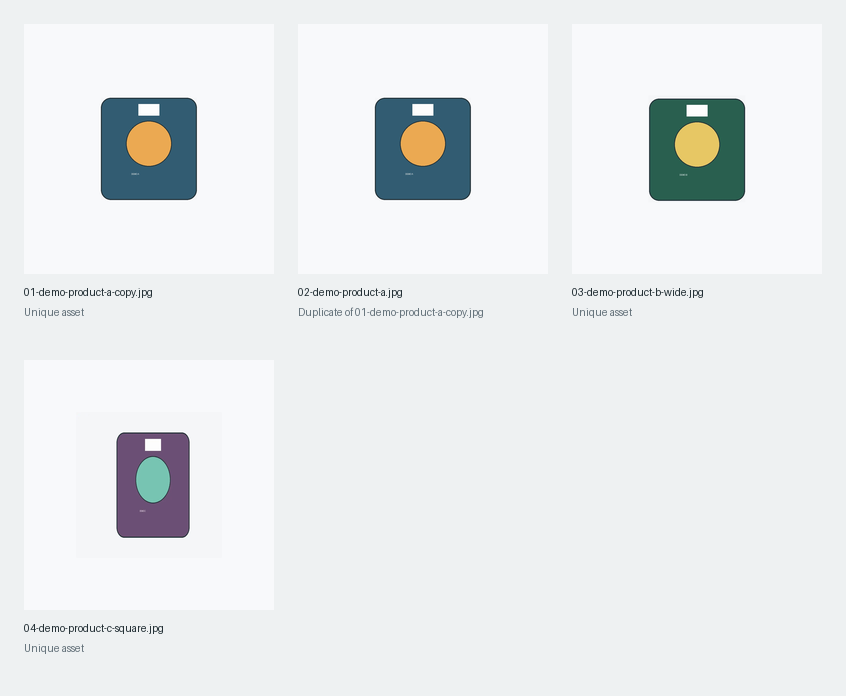

# Product Media Pipeline

[English / README principal](README.md) · Português (Brasil)

Um pipeline reproduzível de processamento de imagens para preparar mídias de produtos para marketplaces. Os arquivos incluídos são amostras geradas para testes, e não imagens de catálogos comerciais.



## O que o projeto faz

- Localiza arquivos JPEG, PNG e WebP.
- Remove margens vazias do fundo e centraliza o objeto.
- Normaliza todas as imagens em uma área quadrada de tamanho consistente.
- Utiliza SHA-256 e um hash de diferença visual para identificar duplicatas.
- Aplica nomes de saída determinísticos e compatíveis com o sistema de arquivos.
- Grava um manifesto JSON auditável e uma folha de contato.
- Preserva as dimensões de entrada e saída para rastreabilidade.

## Demonstração

```bash
python -m pip install -e .
python scripts/generate_demo_assets.py
python -m media_pipeline.cli examples/input generated
```

## Testes

```bash
python -m pip install pytest
pytest -q
```

## Limites de privacidade

Não inclui catálogos privados, contas de marketplace, arquivos enviados por clientes, fotos de marcas, sessões ou diretórios de produção. As imagens de exemplo dos produtos são geradas pelo próprio repositório.

## Licença

MIT
